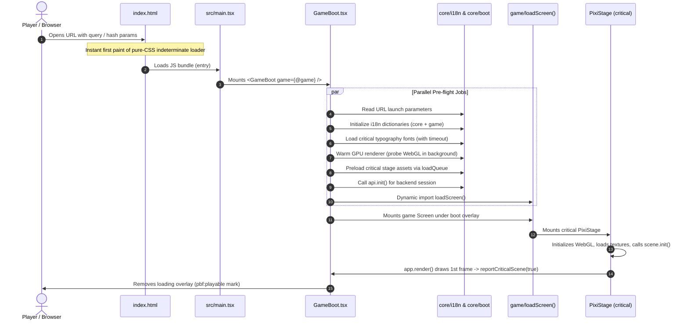

# PBF Game Framework — Complete Architectural & File Guide (Root → Core)

> **Audited & Updated:** 25 Nov 2026  
> Comprehensive reference for all root configurations, developer tooling, and the shared `src/core/` engine modules.

---

## 1. How It All Starts — The Boot Flow



---

## 2. 📄 Root & Configuration Files

### [`index.html`](file:///C:/Users/venka/PBF/pbf-game-framework/index.html)
The single HTML file for every game built on the framework:
- **Zero-JS Inline Loader**: Contains inline CSS with `@keyframes pbfInline` that renders a branded loading bar immediately on HTML parse, preventing white-screen flashes while JavaScript downloads.
- **Dynamic Title Injection**: Uses `%GAME_TITLE%`, which the Vite build plugin replaces with the title defined in the active game's `index.ts`.
- **Clean Favicon**: Sets `<link rel="icon" href="data:,">` to avoid 404 errors on hosting environments lacking custom favicon assets.

### [`package.json`](file:///C:/Users/venka/PBF/pbf-game-framework/package.json)
- **Runtime Dependencies**: Strictly bounded to `pixi.js` (v8.9.2), `react` (v18.3.1), and `react-dom` (v18.3.1).
- **Core Scripts**:
  - `dev`: Starts the Vite dev server for a specified game (e.g. `npm run dev -- higherlower`).
  - `build`: Types checks with `tsc --noEmit` and bundles the target game into static assets.
  - `typecheck`: Checks both `src` and end-to-end test files (`tsc --noEmit -p tests/tsconfig.json`).
  - `check`: Runs the entire suite of Node-native self-checks (`.check.ts`) across core services, view configurations, queues, i18n, round tracking, and game backends.
  - `check:games`: Enforces strict modularity and boundary rules on all folders in `src/games/`.
  - `new-game`: CLI scaffolding tool to generate a new game template.
  - `test:e2e`: Runs Playwright tests against production builds.

### [`vite.config.ts`](file:///C:/Users/venka/PBF/pbf-game-framework/vite.config.ts)
The build orchestrator with 3 specialized plugins:
1. **`gameAssets`**: Isolates game distribution — at build time, it only copies `public/assets/common/` and `public/assets/<GAME_ID>/`. Art assets from other games are never bundled.
2. **`assetVersions`**: Calculates MD5 content hashes (8 characters) for all shipping assets and injects them into `__ASSET_VERSIONS__` for immutable CDN caching.
3. **`startupHints`**: Parses generated bundles and injects `<link rel="modulepreload">` for screen code and Pixi renderer chunks, `<link rel="preload" as="font">` for critical WOFF2 fonts, and `<link rel="preload" as="style">` for screen styles into the HTML `<head>`.

### [`tsconfig.json`](file:///C:/Users/venka/PBF/pbf-game-framework/tsconfig.json)
Configured with `strict: true`, `"moduleResolution": "bundler"`, and `"baseUrl": "src"`. Excludes `*.check.ts` files from the Vite/client TypeScript compilation (these run natively in Node with `--experimental-strip-types`).

### [`playwright.config.ts`](file:///C:/Users/venka/PBF/pbf-game-framework/playwright.config.ts)
Configures automated browser tests against production builds:
- Targets local static server `http://localhost:4173/<game>/`.
- Forces `workers: 1` to prevent parallel GPU/WebGL contention from distorting animation timing.
- Targets installed Google Chrome (`channel: 'chrome'`).
- Auto-spawns `scripts/serve-builds.mjs` via `webServer`.

### [`src/main.tsx`](file:///C:/Users/venka/PBF/pbf-game-framework/src/main.tsx)
The unified React DOM root. Dynamically imports `@game` (resolved by Vite to `src/games/${GAME_ID}/index.ts`) and wraps the application in `<StrictMode>` and `<GameBoot>`.

### [`src/styles.css`](file:///C:/Users/venka/PBF/pbf-game-framework/src/styles.css)
The design system core:
- `@font-face` definitions for Degular (700, 900) and Avenir Next (400, 600, 800) referencing hashed WOFF2 files in `src/core/assets/fonts/`.
- 2-layer CSS Custom Properties: Base Palette (`--pbf-primary-*`, `--pbf-neutral-*`) mapped to Semantics (`--action-primary`, `--surface-card`, `--status-win`, etc.).
- Common UI classes (`.pbf-screen`, `.pbf-btn`, `.pbf-card`, `.pbf-balance`).
- Viewport shell styles (`.app-shell`, `.app-frame`, `.app-rotate`).
- Physics and animation keyframes (`pbfPop`, `pbfBoost`, `pbfCrash`, `pbfLive`, `pbfRise`).
- `prefers-reduced-motion` safety overrides.

---

## 3. 📁 `scripts/` — Developer & CI Automation

### [`scripts/dev.mjs`](file:///C:/Users/venka/PBF/pbf-game-framework/scripts/dev.mjs)
CLI runner for local development. Validates that the requested game exists, sets `process.env.GAME_ID`, and starts Vite on port 3100.

### [`scripts/build.mjs`](file:///C:/Users/venka/PBF/pbf-game-framework/scripts/build.mjs)
Production build runner. Emits static output to `../pbf-game-builds/<GAME_ID>` by default.

### [`scripts/serve-builds.mjs`](file:///C:/Users/venka/PBF/pbf-game-framework/scripts/serve-builds.mjs)
Zero-dependency Node HTTP static server. Serves production bundles under subpaths `/<id>/` to simulate production operator hosting for E2E testing.

### [`scripts/check-games.mjs`](file:///C:/Users/venka/PBF/pbf-game-framework/scripts/check-games.mjs)
Architectural linter that ensures all games comply with framework invariants:
1. Folder names must be strictly lowercase alphanumeric (`[a-z0-9]`).
2. Must export `default defineGame({...})` from `index.ts`.
3. **No Cross-Game Imports**: A game is forbidden from importing from another game's folder. Shared code must reside in `src/core/`.
4. Every mock backend self-check (`*.check.ts`) must be registered in the `package.json` `"check"` script.

### [`scripts/new-game.mjs`](file:///C:/Users/venka/PBF/pbf-game-framework/scripts/new-game.mjs)
Code generator for scaffolding new titles (`npm run new-game <id> "<Title>"`). Creates the game directory, CSS, screen component, mock server, mock test, asset folder, and registers it in `package.json`.

---

## 4. 📁 `src/core/boot/` — Engine Startup & Resource Loading

### [`launchParams.ts`](file:///C:/Users/venka/PBF/pbf-game-framework/src/core/boot/launchParams.ts)
Extracts startup parameters from either search query strings or hash queries (PBF hash pattern `#/home?token=...`, with hash parameters taking precedence):
- `token`: Player auth token.
- `language`: Normalizes language codes, default `'en'`.
- `currency`: Forced uppercase string or null.
- `lobbyUrl`, `bankingUrl`: Validates and accepts only secure `https://` URLs.

### [`assetUrl.ts`](file:///C:/Users/venka/PBF/pbf-game-framework/src/core/boot/assetUrl.ts)
Resolves asset paths relative to `public/assets/`. Appends build-time content hashes (`?v=xxxxxxxx`) for immutable cache control.

### [`loadQueue.ts`](file:///C:/Users/venka/PBF/pbf-game-framework/src/core/boot/loadQueue.ts) & [`loadQueue.check.ts`](file:///C:/Users/venka/PBF/pbf-game-framework/src/core/boot/loadQueue.check.ts)
General-purpose async loading queue:
- **Bounded Concurrency**: Defaults to 6 concurrent requests to stay within HTTP/1.1 limits.
- **Timeouts & Retries**: Wraps tasks with `withTimeout` and retries transient failures.
- **Deduplication**: Deduplicates keys across requests.
- **Cancellation**: Full `AbortSignal` support.
- Throws typed `LoadError` with codes `'TIMEOUT'`, `'FAILED'`, or `'ABORTED'`.

### [`startup.ts`](file:///C:/Users/venka/PBF/pbf-game-framework/src/core/boot/startup.ts)
Instruments startup performance:
- Marks milestones via `performance.mark('pbf:<stage>')` (`bootstrap`, `session`, `fonts`, `code`, `critical-assets`, `renderer-warm`, `critical`, `renderer`, `scene`, `first-render`, `playable`).
- Provides `reportCriticalScene` and `onCriticalScene` listeners to ensure the loading screen remains visible until the canvas has actually rendered its initial frame.

### [`GameBoot.tsx`](file:///C:/Users/venka/PBF/pbf-game-framework/src/core/boot/GameBoot.tsx)
The master orchestrator:
- Loads i18n dictionaries, fonts, assets, backend session, and game screen code in parallel.
- Shows progressive loading bar with percentage.
- Guards against StrictMode double-mounting via `initOnce`.
- Surfaces user-friendly blocking error screens on `ApiError` or `BootFailure` (`MAINTENANCE`, `SESSION_EXPIRED`, `SESSION_INVALID`, `TIMEOUT`, `ASSETS_FAILED`).

---

## 5. 📁 `src/core/i18n/` — Internationalization & Translations

### [`index.ts`](file:///C:/Users/venka/PBF/pbf-game-framework/src/core/i18n/index.ts)
Framework translation store:
- Supports language fallback to English (`en`).
- Handles parameter interpolation (e.g. `translate('score.text', { points: 5 })` replacing `{points}`).
- Supports live language changes via `setLanguage(lang)` without page reloading.
- Automatically synchronizes currency formatting locale via `setMoneyLocale(locale)`.
- Emits console warnings for missing translation keys in development.

### [`en.ts`](file:///C:/Users/venka/PBF/pbf-game-framework/src/core/i18n/en.ts)
Core dictionary providing default translations for the bootloader, buttons (Reload, Lobby), common error messages, and UI labels.

### [`react.ts`](file:///C:/Users/venka/PBF/pbf-game-framework/src/core/i18n/react.ts)
React hooks and helpers:
- `useLanguage()`: Subscribes components to language changes via `useSyncExternalStore`.
- `useCoreT()`: Returns a translation function for core keys.
- `makeTranslator<GameDictionary>()`: Factory that generates strongly typed `t` and `useT` helpers for game-specific dictionaries.

### [`pseudo.ts`](file:///C:/Users/venka/PBF/pbf-game-framework/src/core/i18n/pseudo.ts)
Pseudo-localization engine (`xx` language):
- Replaces standard characters with accented glyphs (`[Áḅç~]`) and expands string length by ~30% while preserving `{placeholder}` tags.
- Allows visual verification of UI layout overflow and missing translation keys without needing full translations.

### [`i18n.check.ts`](file:///C:/Users/venka/PBF/pbf-game-framework/src/core/i18n/i18n.check.ts)
Node self-check testing translation lookups, missing key fallbacks, variable substitutions, live language switching, and pseudo-localization generation.

---

## 6. 📁 `src/core/round/` — Network Resiliency & Server Rounds

### [`serverClock.ts`](file:///C:/Users/venka/PBF/pbf-game-framework/src/core/round/serverClock.ts)
Clock synchronization against server time:
- Uses `monotonicNow()` (`performance.timeOrigin + performance.now()`) to protect against player OS clock manipulation.
- Filters latency using a rolling window of recent round-trip times (RTT); selects the lowest RTT sample where clock offset error is bounded by `RTT / 2`.
- Provides `timed()` helper to piggyback server time tracking onto normal API responses.

### [`mockClock.ts`](file:///C:/Users/venka/PBF/pbf-game-framework/src/core/round/mockClock.ts)
Simulates server clock skew during mock development and testing to ensure client synchronization logic runs under realistic network timing conditions.

### [`actionGuard.ts`](file:///C:/Users/venka/PBF/pbf-game-framework/src/core/round/actionGuard.ts)
Financial transaction and betting safety:
- **`ActionGuard`**: Deduplicates in-flight actions. If a player triggers multiple actions simultaneously (e.g. double-clicking "Bet"), subsequent calls return the existing in-flight Promise.
- **`retryWithSameKey`**: Automatically retries failed requests while reusing the same `requestId` (idempotency key), preventing double-betting on network reconnects.

### [`roundTracker.ts`](file:///C:/Users/venka/PBF/pbf-game-framework/src/core/round/roundTracker.ts)
State synchronizer for server-controlled rounds:
- Ingests server snapshots `{ roundId, phase, seq, phaseEndsAt }`.
- Drops out-of-order, stale (`seq < current.seq`), or duplicate events.
- Enforces valid phase transitions using lifecycle orders (`LIVE_ROUND_ORDER`, `INSTANT_ROUND_ORDER`).
- Maintains a history of finished round IDs to ignore late-arriving packets after round completion.

### [`react.ts`](file:///C:/Users/venka/PBF/pbf-game-framework/src/core/round/react.ts)
React hooks for server-timed rounds:
- `useServerClock()`: Instantiates and memoizes a `ServerClock`.
- `useServerNow()`: Exposes estimated server time updating on an interval.
- `useCountdown()`: Returns `secondsLeft`, `remainingMs`, and `progress` (1 → 0) synced to server deadlines.
- `useAtServerTime()`: Triggers local UI callbacks once the server clock reaches a specified deadline.

### [`round.check.ts`](file:///C:/Users/venka/PBF/pbf-game-framework/src/core/round/round.check.ts)
Node self-check validating clock estimation, ActionGuard in-flight sharing, retry idempotency, and round tracker phase ordering.

---

## 7. 📁 `src/core/pixi/` — PixiJS Rendering Layer

### [`scene.ts`](file:///C:/Users/venka/PBF/pbf-game-framework/src/core/pixi/scene.ts)
Defines scene contracts:
- `PixiScene<P, E>`: Standard interface implementing `init`, `update`, `resize`, and `destroy`.
- `SceneContext<E>`: Provides scenes with `app`, `root` Container, `emit(event)` for communication back to React, and `track(dispose)` for teardown registration.
- **Rule**: Pixi scenes are decoupled from React, services, and external state stores.

### [`PixiStage.tsx`](file:///C:/Users/venka/PBF/pbf-game-framework/src/core/pixi/PixiStage.tsx)
The React-to-Pixi lifecycle bridge:
- Allocates and destroys one Pixi `Application` per mount.
- Handles WebGL context loss via `webglcontextlost`.
- Observes size changes using both Pixi renderer events and native `ResizeObserver`.
- Pauses the animation ticker automatically when the document is hidden (`visibilitychange`).
- Handles `critical` prop: executes `app.render()` immediately upon initialization and notifies `GameBoot`.
- Handles StrictMode mounting and unmounting safely via cancellation flags.

### [`stageAssets.ts`](file:///C:/Users/venka/PBF/pbf-game-framework/src/core/pixi/stageAssets.ts)
Reference-counted texture cache manager:
- Tracks reference counts for active texture aliases.
- Only unloads textures from Pixi `Assets` cache when all scenes referencing them have unmounted.

### [`preload.ts`](file:///C:/Users/venka/PBF/pbf-game-framework/src/core/pixi/preload.ts)
Connects Pixi asset resolution with `loadQueue.ts` to provide bounded concurrency and retries during asset preloading.

### [`warmup.ts`](file:///C:/Users/venka/PBF/pbf-game-framework/src/core/pixi/warmup.ts)
Executes `isWebGLSupported()` early in the boot sequence to initialize the browser's GPU process while network requests are in flight, reducing first-frame render latency on mobile devices by up to 1.2s.

### [`theme.ts`](file:///C:/Users/venka/PBF/pbf-game-framework/src/core/pixi/theme.ts)
Defines design tokens as raw hex values (`0xRRGGBB`) and font mappings (`Degular`, `Avenir Next`) for use within canvas scenes.

### [`viewConfig.ts`](file:///C:/Users/venka/PBF/pbf-game-framework/src/core/pixi/viewConfig.ts) & [`viewConfig.check.ts`](file:///C:/Users/venka/PBF/pbf-game-framework/src/core/pixi/viewConfig.check.ts)
Declarative schema for canvas elements (Text, Sprite, Shape, Group) and canvas viewport sizing (`CanvasConfig`). Validates element IDs, coordinates, bounding dimensions, and styling properties.

### [`buildView.ts`](file:///C:/Users/venka/PBF/pbf-game-framework/src/core/pixi/buildView.ts)
Compiler that converts declarative `viewConfig` trees into live Pixi display hierarchies with token resolution (`{tier}Badge`) and dynamic data bindings.

### [`CanvasFrame.tsx`](file:///C:/Users/venka/PBF/pbf-game-framework/src/core/pixi/CanvasFrame.tsx)
DOM wrapper that enforces responsive height constraints via `clamp(minHeight, heightPct, maxHeight)`.

### [`usePixiEffect.tsx`](file:///C:/Users/venka/PBF/pbf-game-framework/src/core/pixi/usePixiEffect.tsx)
Lightweight hook for mounting short-lived visual effects (such as confetti or ambient glows) without defining a full scene class.

---

## 8. 📁 `src/core/services/` — Pure Logic Services

### [`apiError.ts`](file:///C:/Users/venka/PBF/pbf-game-framework/src/core/services/apiError.ts)
Defines `ApiError<Code>` and the standard `SessionErrorCode` union (`'SESSION_INVALID' | 'SESSION_EXPIRED' | 'MAINTENANCE'`).

### [`money.ts`](file:///C:/Users/venka/PBF/pbf-game-framework/src/core/services/money.ts)
Currency and monetary calculations:
- `roundMoney`: Epsilon-guarded rounding to 2 decimal places.
- `compareMoney`: Safe delta comparison to avoid floating-point inaccuracies.
- `formatMoney`: Formats values using `Intl.NumberFormat`, synchronized with the active i18n locale via `setMoneyLocale`.

### [`RoundEngine.ts`](file:///C:/Users/venka/PBF/pbf-game-framework/src/core/services/RoundEngine.ts)
Pure state machine for timed client phases:
- Holds the current phase and moves to the next one only when the game calls `advance()`. No timers: phase ends come from server time (`core/round`).
- Safe timer cancellation on `stop()`.

### [`mockTransport.ts`](file:///C:/Users/venka/PBF/pbf-game-framework/src/core/services/mockTransport.ts)
Utility for mock servers simulating network latency and mock errors (`?mockInitError=...`).

### [`services.check.ts`](file:///C:/Users/venka/PBF/pbf-game-framework/src/core/services/services.check.ts)
Node self-check testing currency rounding, comparison edge cases, and phase transitions in `RoundEngine`.

---

## 9. 📁 `src/core/ui/` — Shared UI Components

### [`AppShell.tsx`](file:///C:/Users/venka/PBF/pbf-game-framework/src/core/ui/AppShell.tsx)
Top-level presentation container. Centers desktop viewport to a mobile aspect ratio (`max-width: 480px`, `width: 45vh`), spans full width on mobile devices, and displays a portrait orientation reminder when necessary.

### [`GameHeader.tsx`](file:///C:/Users/venka/PBF/pbf-game-framework/src/core/ui/GameHeader.tsx)
Header component displaying the eyebrow label, main game title, custom badges, and live formatted balance pill.

### [`StakeChips.tsx`](file:///C:/Users/venka/PBF/pbf-game-framework/src/core/ui/StakeChips.tsx)
Row of selectable stake buttons with `aria-pressed` states and disabled styling during active rounds.

### [`GameLayout.tsx`](file:///C:/Users/venka/PBF/pbf-game-framework/src/core/ui/GameLayout.tsx)
Responsive layout container splitting the screen into distinct areas:
- `header`: Header bar.
- `stage`: Canvas or interactive play area.
- `controls`: Betting and action buttons.
- `info`: Independent scrolling area for history, live feeds, or game rules.
- `overlays`: Dialogs and tutorials.

### [`layoutScroll.ts`](file:///C:/Users/venka/PBF/pbf-game-framework/src/core/ui/layoutScroll.ts)
Utility providing `resetLayoutScroll()` to scroll all layout containers back to top on view transitions.

---

## 10. 📁 `src/core/game/` — Game Definition

### [`defineGame.ts`](file:///C:/Users/venka/PBF/pbf-game-framework/src/core/game/defineGame.ts)
Defines the `GameDefinition<Api, Init>` contract:
- `id`: Unique lowercase identifier.
- `title`: Display title.
- `renderer`: `'pixi'` (enables renderer warm-up and canvas handshake) or `'dom'` (pure HTML/CSS).
- `translations`: Map of dictionary loaders (`{ en: () => import('./i18n/en') }`).
- `preload`: Array of textures loaded prior to initial render.
- `createApi(launch)`: Factory returning the API client instance.
- `loadScreen()`: Dynamic import returning the root React screen component.
- `defineGame()`: Type-preserving identity helper.

---

## 11. Complete Core Architecture Map

```mermaid
graph TD
    subgraph Boot["core/boot"]
        GB[GameBoot.tsx]
        LP[launchParams.ts]
        LQ[loadQueue.ts]
        SU[startup.ts]
        AU[assetUrl.ts]
    end

    subgraph I18N["core/i18n"]
        I18N_IDX[index.ts store]
        I18N_REACT[react.ts hooks]
        I18N_PSEUDO[pseudo.ts xx-lang]
        I18N_EN[en.ts core dict]
    end

    subgraph Round["core/round"]
        SC[serverClock.ts]
        AG[actionGuard.ts]
        RT[roundTracker.ts]
        R_REACT[react.ts hooks]
    end

    subgraph Pixi["core/pixi"]
        PS[PixiStage.tsx]
        SCENE[scene.ts]
        SA[stageAssets.ts]
        PRE[preload.ts]
        WARM[warmup.ts]
        VC[viewConfig.ts]
        BV[buildView.ts]
        CF[CanvasFrame.tsx]
    end

    subgraph Services["core/services"]
        MONEY[money.ts]
        RE[RoundEngine.ts]
        ERR[apiError.ts]
    end

    subgraph UI["core/ui"]
        AS[AppShell.tsx]
        GH[GameHeader.tsx]
        STAKE[StakeChips.tsx]
        GL[GameLayout.tsx]
        LS[layoutScroll.ts]
    end

    GB --> LP
    GB --> LQ
    GB --> SU
    GB --> AU
    GB --> I18N_IDX
    GB --> WARM
    GB --> AS

    I18N_IDX --> MONEY
    I18N_IDX --> I18N_EN
    I18N_IDX --> I18N_PSEUDO
    I18N_REACT --> I18N_IDX

    PS --> SCENE
    PS --> SA
    PS --> SU
    SA --> PRE
    PRE --> LQ
    BV --> VC
    CF --> VC

    R_REACT --> SC
    AG -.->|Idempotency| Round
